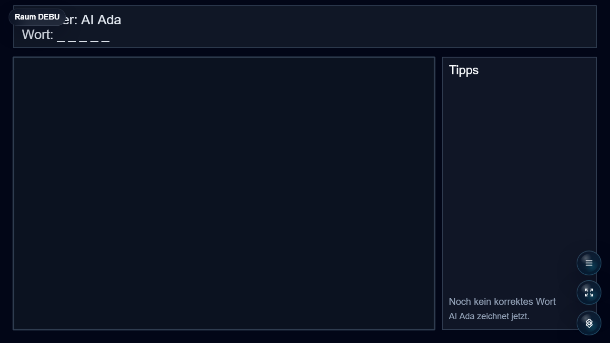

# Zeichnen & Erraten

Drawing and guessing party game for Open Party Lab with phone drawing controls and word categories.

The drawer sees pointer strokes immediately through a local preview, even while waiting for the server echo. Bounded client correlation IDs match the preview to the authoritative stroke without changing server-owned stroke IDs or rules. Clearing also hides delayed echoes of earlier strokes. Controller component checks cover a two-second echo delay, quick consecutive strokes, clearing, touch movement, release endpoints, round reset and portrait/landscape layouts; physical-phone WLAN latency remains unverified.

The Ü18 category now has an expanded pool of explicit anatomy and sex terms, sexual slang, profanity, alcohol and cannabis prompts. Select Ü18 or the combined category in setup to use them; U18 retains its separate family-friendly pool.



## Status

Beta. The drawing and guessing loop is already good to play locally. Still needs drawing-feel refinement, category/content review, and result presentation polish before a stable release.

After a correct guess or timeout, the host keeps the drawing visible and replaces the guess list with the revealed word and this game's standings, including each round's point gain. The correct guesser and drawer each earn one point. These totals carry through consecutive Draw & Guess rounds and start at zero for a new game session; room-wide scores are not used in this panel.

## Run Through Open Party Lab

This repo is not a standalone app. Run it through the Open Party Lab platform.

Recommended layout:

```text
Open-Party-Lab/
  local-games/
    zeichnen-und-erraten/
```

From the Platform repo:

```bash
npm install
npm run games:sync-local
npm run dev:all
```

The Platform loads this game only when the repo exists locally and `npm run games:sync-local` links it. Missing optional games are skipped.

## GitHub Metadata

Description:

```text
Drawing and guessing party game for Open Party Lab with phone drawing controls and word categories.
```

Suggested topics:

```text
open-party-lab party-game browser-game phaser typescript local-multiplayer drawing-game
```

## Package Entrypoints

- `@open-party-lab/game-zeichnen-und-erraten/manifest`
- `@open-party-lab/game-zeichnen-und-erraten/protocol`
- `@open-party-lab/game-zeichnen-und-erraten/server`
- `@open-party-lab/game-zeichnen-und-erraten/host`
- `@open-party-lab/game-zeichnen-und-erraten/controller`

The Platform should import only these public entrypoints.

## Development Checks

```bash
npm install
npm run typecheck
npm run build
npm run pack:dry-run
```

For visual checks, start Open Party Lab, add virtual controllers when needed, and capture host screenshots through a browser.

## License

Code is licensed under the Apache License 2.0. See [LICENSE](LICENSE).

Assets, generated media, word lists, prompts, and third-party references may need separate rights review before public store distribution.
